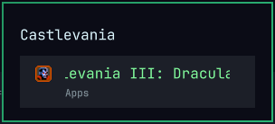

# OmaMenu

**Stock Omarchy menu, with one habit fixed: highlighted rows that would
normally die behind an ellipsis scroll far enough to read.**



Works in Apps, Fonts, Gaming, plugin enable/disable/clone/remove (including
the id subline), and search results. Idle rows still elide. Highlighted rows
that actually overflow pause, scroll once through the hidden tail, pause,
then reset — no ping-pong, no endless wrap.

## Why

Omarchy’s menu is narrow on purpose. Long labels (`Heroic (Epic Games)`,
`RetroArch Game Launcher`, `io.github.…` plugin ids) get cut with `…`.
Hovering or arrowing onto them leaves you guessing. OmaMenu shows the
rest when you care, and stays quiet when the name already fits.

It also keeps the stock Apps filter: 4.5’s shared `AppLibrary` owns
`/usr/share/omarchy/default/omarchy/launcher.hides`, the usual
`NoDisplay` / `OnlyShowIn` scan, icons and launching, so Avahi and friends
stay out of the list without a private copy.

This is a small fork of stock menu (marquee only) — rebased onto Omarchy 4.5
so upstream menu fixes land here when we refresh the repo; grab them with
`omarchy plugin update`. You don’t need to rebase anything yourself.

## Install

```sh
omarchy plugin add https://github.com/AlxWolfenstein97/omamenu.git --enable
```

That clones into `~/.config/omarchy/plugins/io.github.alxwolfenstein97.omamenu`
and replaces stock `omarchy.menu` (same `clonedFrom` routing the built-in
clone path uses). Or from a checkout:

```sh
~/.config/omarchy/plugins/io.github.alxwolfenstein97.omamenu/install.sh
```

**Needs:** Omarchy shell / Quickshell. Super+Space opens the menu.

No extra packages — OmaMenu is a Quickshell menu clone, not a Pillow mockup
carousel. (The Extender plugins that *do* draw PNGs pull `python-pillow`
themselves; see [Chroma](https://github.com/AlxWolfenstein97/chroma) for the
family map.)

## Disable vs remove

| Action | What happens |
|--------|----------------|
| `./uninstall.sh` | Disables this clone and re-enables stock `omarchy.menu`. No packages to drop. |
| `omarchy plugin remove …` | Deletes the plugin folder after uninstall. |

**Full wipe** — copy-paste:

```sh
~/.config/omarchy/plugins/io.github.alxwolfenstein97.omamenu/uninstall.sh
omarchy plugin remove io.github.alxwolfenstein97.omamenu
```

## Notes

- 4.5 injects the shell’s shared `AppLibrary` into menu-kind plugins, so
  OmaMenu carries no private `AppSearch.js` copy, hide-list scan or icon index.
  Apps, hidden entries and icons stay in lockstep with stock.
- Bar widget IPC targets stay `omarchy.menu`; the shell routes them through
  `clonedFrom`.

## Limits

- Marquee only runs on highlighted overflow rows; idle rows still elide.
- The 4.5 grid launcher already avoids most label truncation; OmaMenu keeps
  the marquee for the list, search, font and plugin rows where it still helps.

## Fresh VM smoke test

```sh
omarchy plugin add https://github.com/AlxWolfenstein97/omamenu.git --enable
# disable stock menu if the clone owns the bar slot (Workshop / clone flow)
omarchy-restart-shell
# Apps submenu: rows and icons come from the shell's shared AppLibrary.
# Highlight an overflowing row (long app name, font, plugin id) and watch it
# scroll; idle rows should still elide.
```
## Credits

- [Omarchy](https://omarchy.org/) — the first-party menu this clones.
- [OMCP](https://github.com/btsouth/omarchy-omcp) — MCP desktop bridge
  (screenshots, themes, window focus, …). This plugin was basically built
  through it: open the menu, poke Apps / Gaming / Fonts / plugin pickers,
  catch empty lists and mid-marquee bugs, swap to Hackerman for the preview,
  repeat. Install with
  `omarchy plugin add https://github.com/btsouth/omarchy-omcp --enable`.

## License

MIT — see [LICENSE](LICENSE). Built on Omarchy’s first-party menu.
